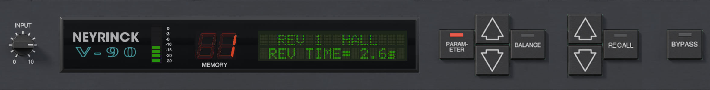

# Welcome To V-90

V-90 is a set of five audio plug-ins that bring the effect programs of a classic late-1980s digital multi-effects unit to your DAW. Each plug-in has the unit's front panel: the same programs, the same parameters and ranges, and the same LCD text.

## The V-90 Plug-Ins

| Plug-in | Programs (memory numbers) |
|---|---|
| [V-90 Symphonic](plugins/symphonic.md) | 15 Symphonic |
| [V-90 Reverbs](plugins/reverbs.md) | 1 Rev 1 Hall, 2 Rev 2 Room, 3 Rev 3 Vocal, 4 Rev 4 Plate, 20 Reverb & Gate |
| [V-90 Reflections](plugins/reflections.md) | 5 Early Ref. 1, 6 Early Ref. 2, 16 Gate Reverb, 17 Reverse Gate |
| [V-90 Modulations](plugins/modulations.md) | 7 Delay L,R, 8 Stereo Echo, 9 Stereo Flange A, 10 Stereo Flange B, 11 Chorus A, 12 Chorus B, 13 Stereo Phasing, 14 Tremolo, 27 Auto Pan, 29 Delay Vibrato |
| [V-90 Pitch Change](plugins/pitch-change.md) | 21 Pitch Change A, 22 Pitch Change B, 23 Pitch Change C, 24 Pitch Change D |

The **V-90 Complete** installer installs all five plug-ins. See the [Memory List](reference/memory-list.md) for every program in memory order.

## Features

* The original programs, with the unit's parameters, value steps and factory settings.
* A front panel that works like the hardware: PARAMETER, BALANCE, MEMORY and RECALL keys, a two-line LCD and a memory display.
* Each memory keeps its own settings while you try others.
* Every parameter can be automated, and the parameters that are lists or switches (such as Memory and Bypass) show as lists or switches in your DAW.
* MIDI control: play Pitch Change A and D from a keyboard, and trigger Reverb & Gate and Delay Vibrato with MIDI notes.
* Mono-to-stereo and stereo-to-stereo.
* AAX Native, AAX DSP (except V-90 Reflections), AU, VST 3 and, on Windows, VST.
* A resizable window.

## Getting Started

* [Quick Start Guide](quick-start-guide.md): up and running in a few minutes.
* [Installation](getting-started/installation.md) and [Activating the License](getting-started/licensing.md).
* [The V-90 Panel](using/panel.md): what each control does.
