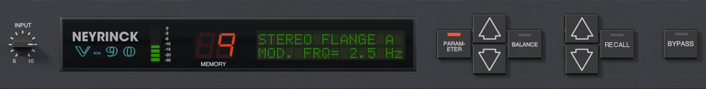

# V-90 Modulations

V-90 Modulations has the original unit's delay and modulation programs: stereo delays and echoes, flangers, choruses, phasing, tremolo, auto pan and a delayed vibrato.

| Memory | Program | Character |
|---|---|---|
| 7 | Delay L,R | Independent left and right delays, up to 500 ms. |
| 8 | Stereo Echo | Left and right echoes with feedback, up to 250 ms. |
| 9 | Stereo Flange A | Stereo flanger. |
| 10 | Stereo Flange B | Stereo flanger: a slow, deep sweep. |
| 11 | Chorus A | Stereo chorus. |
| 12 | Chorus B | Stereo chorus, faster and with less level modulation. |
| 13 | Stereo Phasing | Stereo phaser. |
| 14 | Tremolo | Level modulation. |
| 27 | Auto Pan | Automatic panning. |
| 29 | Delay Vibrato | A vibrato that starts after a delay and fades in, as a singer's does. |

Choose a program with the MEMORY keys and RECALL. See [Memories and Recall](../using/memories.md).

## Delay L,R

Two delays, one for each output. In Delay L,R, the left and right echoes feed back into each other.

| Parameter (LCD) | Host name | Range | Default | Description |
|---|---|---|---|---|
| **Lch DLY** | Delay L | 0.1 ms – 500.0 ms | 100.0 ms | Left channel delay time. |
| **Lch F.B** | Feedback L | -99 % – +99 % | +0 % | Left channel feedback: the number of repeats. Negative values invert the polarity of the feedback. |
| **Rch DLY** | Delay R | 0.1 ms – 500.0 ms | 200.0 ms | Right channel delay time. |
| **Rch F.B** | Feedback R | -99 % – +99 % | +0 % | Right channel feedback: the number of repeats. Negative values invert the polarity of the feedback. |
| **HIGH** | High | 0.1 – 1.0 | 1.0 | High-frequency damping of the repeats: lower values make each repeat darker. 1.0 is no damping. |
| **BALANCE** | Balance | 0 % – 100 % | 100 % | Mix of dry and effect sound. 0 % is dry only, 100 % is effect only. Use 100 % when the plug-in is on an effect return. |

## Stereo Echo

Two separate echoes, each feeding back on itself. The slightly different left and right times of the factory setting give a wide stereo echo.

| Parameter (LCD) | Host name | Range | Default | Description |
|---|---|---|---|---|
| **Lch DLY** | Delay L | 0.1 ms – 250.0 ms | 170.0 ms | Left channel delay time. |
| **Lch F.B** | Feedback L | -99 % – +99 % | +60 % | Left channel feedback: the number of repeats. Negative values invert the polarity of the feedback. |
| **Rch DLY** | Delay R | 0.1 ms – 250.0 ms | 178.0 ms | Right channel delay time. |
| **Rch F.B** | Feedback R | -99 % – +99 % | +58 % | Right channel feedback: the number of repeats. Negative values invert the polarity of the feedback. |
| **HIGH** | High | 0.1 – 1.0 | 0.9 | High-frequency damping of the repeats: lower values make each repeat darker. 1.0 is no damping. |
| **BALANCE** | Balance | 0 % – 100 % | 100 % | Mix of dry and effect sound. 0 % is dry only, 100 % is effect only. Use 100 % when the plug-in is on an effect return. |

## Stereo Flange A and B

A flanger: a short delay swept by a modulation and mixed with the dry sound. A and B have the same parameters; B starts with a slower, deeper sweep and more effect in the mix. The defaults shown are Stereo Flange A's.

| Parameter (LCD) | Host name | Range | Default | Description |
|---|---|---|---|---|
| **MOD. FRQ** | Mod Freq | 0.1 Hz – 20.0 Hz | 2.5 Hz | Modulation speed. |
| **MOD. DEPTH** | Mod Depth | 0 % – 100 % | 50 % | Modulation depth. |
| **MOD. DLY** | Mod Delay | 0.1 ms – 100.0 ms | 1.2 ms | Base delay that the modulation sweeps around. |
| **F.B. GAIN** | Feedback Gain | 0 % – 99 % | 35 % | Feedback: how much of the effect is fed back into it. Higher values give a more pronounced, resonant effect. |
| **BALANCE** | Balance | 0 % – 100 % | 50 % | Mix of dry and effect sound. 0 % is dry only, 100 % is effect only. Use 100 % when the plug-in is on an effect return. |

| Program | MOD. FRQ | MOD. DEPTH | MOD. DLY | F.B. GAIN | BALANCE |
|---|---|---|---|---|---|
| Stereo Flange A | 2.5 Hz | 50 % | 1.2 ms | 35 % | 50 % |
| Stereo Flange B | 0.5 Hz | 90 % | 1.0 ms | 40 % | 75 % |

## Chorus A and B

A chorus with both pitch (delay) modulation and level (amplitude) modulation. The defaults shown are Chorus A's.

| Parameter (LCD) | Host name | Range | Default | Description |
|---|---|---|---|---|
| **MOD. FRQ** | Mod Freq | 0.1 Hz – 20.0 Hz | 0.2 Hz | Modulation speed. |
| **DM DEPTH** | Mod Depth | 0 % – 100 % | 50 % | Delay modulation depth: how far the pitch of the chorus voices wanders. |
| **AM DEPTH** | AM Depth | 0 % – 100 % | 40 % | Amplitude modulation depth: how much the level of the chorus voices varies. |
| **BALANCE** | Balance | 0 % – 100 % | 100 % | Mix of dry and effect sound. 0 % is dry only, 100 % is effect only. Use 100 % when the plug-in is on an effect return. |

| Program | MOD. FRQ | DM DEPTH | AM DEPTH | BALANCE |
|---|---|---|---|---|
| Chorus A | 0.2 Hz | 50 % | 40 % | 100 % |
| Chorus B | 0.6 Hz | 50 % | 10 % | 100 % |

## Stereo Phasing

A stereo phaser.

| Parameter (LCD) | Host name | Range | Default | Description |
|---|---|---|---|---|
| **MOD. FRQ** | Mod Freq | 0.1 Hz – 20.0 Hz | 1.1 Hz | Modulation speed. |
| **MOD. DEPTH** | Mod Depth | 0 % – 100 % | 100 % | Modulation depth. |
| **MOD. DLY** | Mod Delay | 0.1 ms – 8.0 ms | 3.0 ms | Base delay that the modulation sweeps around. |
| **BALANCE** | Balance | 0 % – 100 % | 100 % | Mix of dry and effect sound. 0 % is dry only, 100 % is effect only. Use 100 % when the plug-in is on an effect return. |

## Tremolo

Modulates the level of the sound.

| Parameter (LCD) | Host name | Range | Default | Description |
|---|---|---|---|---|
| **MOD. FRQ** | Mod Freq | 0.1 Hz – 20.0 Hz | 6.0 Hz | Modulation speed. |
| **MOD. DEPTH** | Mod Depth | 0 % – 100 % | 50 % | Modulation depth. |
| **BALANCE** | Balance | 0 % – 100 % | 100 % | Mix of dry and effect sound. 0 % is dry only, 100 % is effect only. Use 100 % when the plug-in is on an effect return. |

## Auto Pan

Moves the sound between the left and right outputs.

| Parameter (LCD) | Host name | Range | Default | Description |
|---|---|---|---|---|
| **PAN SPEED** | Mod Freq | 0.1 Hz – 20.0 Hz | 0.7 Hz | Speed of the panning. |
| **DIRECTION** | Direction | L → R, L ← R, L ↔ R | L → R | Direction of the panning: L → R, L ← R, or L ↔ R (back and forth). |
| **DEPTH** | Mod Depth | 0 % – 100 % | 75 % | Width of the panning. |
| **BALANCE** | Balance | 0 % – 100 % | 100 % | Mix of dry and effect sound. 0 % is dry only, 100 % is effect only. Use 100 % when the plug-in is on an effect return. |

## Delay Vibrato

When triggered, a vibrato starts after VIB DLY and fades in over VIB RISE. It is triggered by the input level reaching TRG. LEVEL or, with MIDI TRG. ON (the default), by a MIDI note. See [MIDI Control](../using/midi.md).

| Parameter (LCD) | Host name | Range | Default | Description |
|---|---|---|---|---|
| **TRG. LEVEL** | Trigger Level | 1 – 100 | 100 | Input level that triggers the effect. Lower values trigger on quieter signals. |
| **VIB DLY** | Vibrato Delay | 1 ms – 12001 ms | 400 ms | Time from the trigger to the start of the vibrato. |
| **VIB RISE** | Attack | 5 ms – 32000 ms | 1400 ms | Time the vibrato takes to reach full depth. |
| **VIB FRQ** | Mod Freq | 0.1 Hz – 20.0 Hz | 7.0 Hz | Vibrato speed. |
| **VIB DEPTH** | Mod Depth | 0 % – 100 % | 40 % | Vibrato depth. |
| **MIDI TRG.** | MIDI Trigger | Off, On | On | When ON, a MIDI note-on triggers the effect instead of the input level. |
| **BALANCE** | Balance | 0 % – 100 % | 100 % | Mix of dry and effect sound. 0 % is dry only, 100 % is effect only. Use 100 % when the plug-in is on an effect return. |

## AAX DSP

V-90 Modulations runs as AAX Native and AAX DSP. On DSP it needs one DSP chip at 96 kHz.
