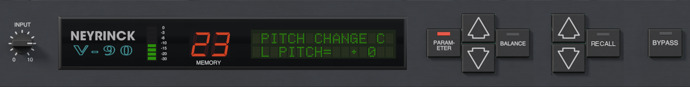

# V-90 Pitch Change

V-90 Pitch Change has the original unit's four pitch-shifting programs: for harmonies, doubling, detuning and special effects.

| Memory | Program | Character |
|---|---|---|
| 21 | Pitch Change A | One shifted voice, with feedback. Can be played from a MIDI keyboard. |
| 22 | Pitch Change B | Two shifted voices, mixed to both outputs. |
| 23 | Pitch Change C | Two shifted voices, one on the left output and one on the right. |
| 24 | Pitch Change D | One shifted voice with feedback, like A, with a different pitch-shifting method. Can be played from a MIDI keyboard. |

V-90 Pitch Change starts with **Pitch Change C**, whose factory setting detunes the left and right sides slightly up and down for a wide doubling effect.

Choose a program with the MEMORY keys and RECALL. See [Memories and Recall](../using/memories.md).

## Pitch Change A and D

One pitch-shifted voice. F.B. GAIN feeds the shifted voice back into the shifter, so each repeat is shifted again: with a DELAY, this gives rising or falling arpeggio effects.

With BASE KEY on, MIDI notes set PITCH. See [MIDI Control](../using/midi.md).

| Parameter (LCD) | Host name | Range | Default | Description |
|---|---|---|---|---|
| **PITCH** | Pitch 1 | -12 – +12 | +0 | Pitch shift in semitones, ±1 octave. |
| **FINE** | Fine 1 | -100 – +100 | +0 | Fine pitch shift, in cents (1/100 semitone). |
| **DELAY** | Delay 1 | 0.1 ms – 400.0 ms | 0.1 ms | Delay of the shifted voice. |
| **F.B. GAIN** | Feedback Gain | 0 % – 99 % | 0 % | Feedback: how much of the effect is fed back into it. Higher values give a more pronounced, resonant effect. |
| **BASE KEY** | Base Key | Off, C1 – C6 | C3 | The MIDI note that plays the pitch unshifted. A MIDI note sets PITCH to its distance from BASE KEY. OFF ignores MIDI notes. See [MIDI Control](../using/midi.md). |
| **BALANCE** | Balance | 0 % – 100 % | 100 % | Mix of dry and effect sound. 0 % is dry only, 100 % is effect only. Use 100 % when the plug-in is on an effect return. |

## Pitch Change B

Two pitch-shifted voices, each with its own pitch and delay, both heard on both outputs. The factory setting detunes the voices 8 cents up and 8 cents down, the second one 20 ms later.

| Parameter (LCD) | Host name | Range | Default | Description |
|---|---|---|---|---|
| **1 PITCH** | Pitch 1 | -12 – +12 | +0 | Voice 1 pitch shift in semitones. |
| **1 FINE** | Fine 1 | -100 – +100 | +8 | Voice 1 fine pitch shift, in cents. |
| **1 DLY** | Delay 1 | 0.1 ms – 400.0 ms | 0.1 ms | Voice 1 delay. |
| **2 PITCH** | Pitch 2 | -12 – +12 | +0 | Voice 2 pitch shift in semitones. |
| **2 FINE** | Fine 2 | -100 – +100 | -8 | Voice 2 fine pitch shift, in cents. |
| **2 DLY** | Delay 2 | 0.1 ms – 400.0 ms | 20.0 ms | Voice 2 delay. |
| **BALANCE** | Balance | 0 % – 100 % | 100 % | Mix of dry and effect sound. 0 % is dry only, 100 % is effect only. Use 100 % when the plug-in is on an effect return. |

## Pitch Change C

Two pitch-shifted voices, the first on the left output and the second on the right.

| Parameter (LCD) | Host name | Range | Default | Description |
|---|---|---|---|---|
| **L PITCH** | Pitch 1 | -12 – +12 | +0 | Left channel pitch shift in semitones. |
| **L FINE** | Fine 1 | -100 – +100 | +8 | Left channel fine pitch shift, in cents. |
| **L DLY** | Delay 1 | 0.1 ms – 200.0 ms | 0.1 ms | Left channel delay. |
| **R PITCH** | Pitch 2 | -12 – +12 | +0 | Right channel pitch shift in semitones. |
| **R FINE** | Fine 2 | -100 – +100 | -8 | Right channel fine pitch shift, in cents. |
| **R DLY** | Delay 2 | 0.1 ms – 200.0 ms | 0.1 ms | Right channel delay. |
| **BALANCE** | Balance | 0 % – 100 % | 100 % | Mix of dry and effect sound. 0 % is dry only, 100 % is effect only. Use 100 % when the plug-in is on an effect return. |

## AAX DSP

V-90 Pitch Change runs as AAX Native and AAX DSP. On DSP it needs one DSP chip at 96 kHz.
