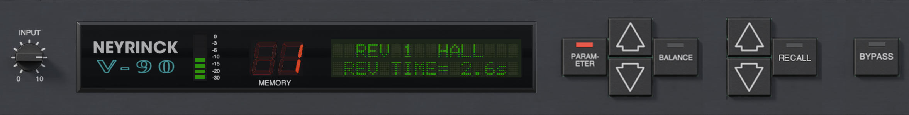

# V-90 Reverbs

V-90 Reverbs has the original unit's reverb programs: four classic reverbs and a gated reverb.

| Memory | Program | Character |
|---|---|---|
| 1 | Rev 1 Hall | A large concert hall. |
| 2 | Rev 2 Room | A smaller room, with a shorter, denser decay. |
| 3 | Rev 3 Vocal | A reverb tuned for vocals, with a longer pre-delay and a high-pass filter to keep it clear. |
| 4 | Rev 4 Plate | A bright, dense plate reverb. |
| 20 | Reverb & Gate | A reverb followed by a gate that cuts it off, for the classic gated drum sound. |

Choose a program with the MEMORY keys and RECALL. See [Memories and Recall](../using/memories.md).

## Rev 1 Hall, Rev 2 Room, Rev 3 Vocal, Rev 4 Plate

These four share the same parameters; each has its own factory settings. The defaults shown are Rev 1 Hall's.

| Parameter (LCD) | Host name | Range | Default | Description |
|---|---|---|---|---|
| **REV TIME** | Rev Time | 0.3 s – 99.0 s | 2.6 s | Reverb time: how long the reverb takes to decay by 60 dB. |
| **HIGH** | High | 0.1 – 1.0 | 0.6 | High-frequency reverb time, as a ratio of REV TIME. Lower values make the highs die away sooner, for a darker, more natural decay. |
| **DELAY** | Delay | 0.1 ms – 50.0 ms | 30.0 ms | Initial delay before the reverb starts. |
| **HPF** | High Pass | Thru – 1.0 kHz | Thru | High-pass filter on the effect sound. THRU is off. |
| **LPF** | Low Pass | 1.0 kHz – Thru | 8.0 kHz | Low-pass filter on the effect sound. THRU is off. |
| **BALANCE** | Balance | 0 % – 100 % | 100 % | Mix of dry and effect sound. 0 % is dry only, 100 % is effect only. Use 100 % when the plug-in is on an effect return. |

### Factory Settings

| Program | REV TIME | HIGH | DELAY | HPF | LPF | BALANCE |
|---|---|---|---|---|---|---|
| Rev 1 Hall | 2.6 s | 0.6 | 30.0 ms | THRU | 8.0 kHz | 100 % |
| Rev 2 Room | 1.5 s | 0.7 | 20.0 ms | THRU | 8.0 kHz | 100 % |
| Rev 3 Vocal | 2.4 s | 0.5 | 45.0 ms | 80 Hz | 8.0 kHz | 100 % |
| Rev 4 Plate | 1.8 s | 0.7 | 10.0 ms | 40 Hz | 10 kHz | 100 % |

## Reverb & Gate

A reverb whose output passes through a gate. When the input level reaches TRG. LEVEL, the gate opens, stays open for HOLD, then closes over RELEASE. With a short HOLD and RELEASE, a long reverb is cut off abruptly: the classic gated snare.

With MIDI TRG. set to ON, MIDI notes open the gate instead of the input level. See [MIDI Control](../using/midi.md).

| Parameter (LCD) | Host name | Range | Default | Description |
|---|---|---|---|---|
| **REV TIME** | Rev Time | 0.3 s – 99.0 s | 2.0 s | Reverb time: how long the reverb takes to decay by 60 dB. |
| **HIGH** | High | 0.1 – 1.0 | 0.6 | High-frequency reverb time, as a ratio of REV TIME. Lower values make the highs die away sooner, for a darker, more natural decay. |
| **DELAY** | Delay | 0.1 ms – 50.0 ms | 10.0 ms | Initial delay before the reverb starts. |
| **HPF** | High Pass | Thru – 1.0 kHz | Thru | High-pass filter on the effect sound. THRU is off. |
| **LPF** | Low Pass | 1.0 kHz – Thru | Thru | Low-pass filter on the effect sound. THRU is off. |
| **TRG. LEVEL** | Trigger Level | 1 – 100 | 65 | Input level that triggers the effect. Lower values trigger on quieter signals. |
| **HOLD** | Hold | 1 ms – 12001 ms | 150 ms | How long the gate stays open after it is triggered. |
| **RELEASE** | Release | 5 ms – 32000 ms | 5 ms | How long the gate takes to close after HOLD. |
| **MIDI TRG.** | MIDI Trigger | Off, On | Off | When ON, a MIDI note-on triggers the effect instead of the input level. |
| **BALANCE** | Balance | 0 % – 100 % | 100 % | Mix of dry and effect sound. 0 % is dry only, 100 % is effect only. Use 100 % when the plug-in is on an effect return. |

## AAX DSP

V-90 Reverbs runs as AAX Native and AAX DSP. On DSP it needs one DSP chip at 96 kHz.
