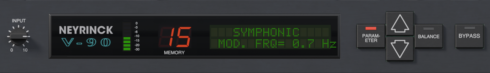

# V-90 Symphonic

V-90 Symphonic is memory 15 of the original unit: the **Symphonic** effect, a rich, wide, multi-voice chorus. It thickens and spreads anything from guitars and keyboards to vocals and strings, and turns a mono source into a lush stereo one.

V-90 Symphonic has one program, so its panel has no MEMORY keys or RECALL key. It is simple to adjust with three parameters.

## Parameters

Press **PARAMETER** to switch between MOD. FRQ and MOD. DEPTH, and **BALANCE** to select BALANCE.

| Parameter (LCD) | Host name | Range | Default | Description |
|---|---|---|---|---|
| **MOD. FRQ** | Frequency | 0.1 – 40.0 Hz | 0.7 Hz | Modulation speed. |
| **MOD. DEPTH** | Depth | 0 – 100 % | 50 % | Modulation depth. |
| **BALANCE** | Balance | 0 – 100 % | 100 % | Mix of dry and effect sound. Use 100 % on an effect return. |

## Tips

* Slow speeds (below 1 Hz) and moderate depth give the classic wide, shimmering sound.
* For a subtle widening on a lead vocal, use it on an effect return and blend it in with the send level.
* Higher speeds give a vibrato-like warble.

## AAX DSP

V-90 Symphonic runs as AAX Native and AAX DSP on Pro Tools HDX systems.
