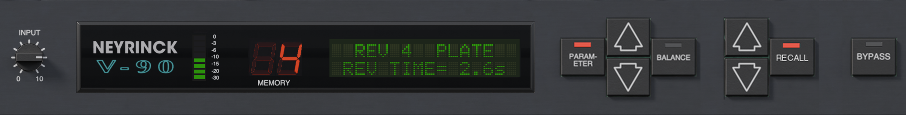

# Memories and Recall

V-90 Reverbs, Reflections, Modulations and Pitch Change each hold several programs. As on the original unit, each program is a **memory** with its own number, shown on the MEMORY display.

## Choosing a Memory

1. Press **MEMORY ▲** or **MEMORY ▼**. The memory number blinks, the LCD shows the program's name, and the RECALL light comes on. The program you were playing keeps playing.
2. Keep pressing the MEMORY keys until you reach the program you want. They wrap around from the last memory to the first.
3. Press **RECALL** to load it.

To leave without changing the program, press PARAMETER, BALANCE or ▲/▼, or step back to the playing memory.

## Each Memory Keeps Its Settings

Every memory remembers its own parameter values. If you edit Rev 1 Hall, switch to Rev 4 Plate and later come back to Rev 1 Hall, your Rev 1 Hall settings are still there. All the memories' settings are saved with your session.

The parameters your DAW shows are always those of the playing memory. A change from the panel, from automation or from a control surface goes to the playing memory.

## Returning to the Factory Settings

* **One parameter:** Option-click (Alt-click on Windows) the LCD to return the parameter shown to its factory value.
* **The whole memory:** press **RECALL** without choosing another memory first. All of the playing memory's parameters return to their factory values. Your DAW can undo this.

## Changing Memory from the DAW

Memory is also a parameter (**Memory**) that you can automate or set from your DAW's controls. It shows as a list of the programs. Changing it from anywhere brings in that memory's own settings.

!!! note
    V-90 Symphonic has a single program and no memories.
