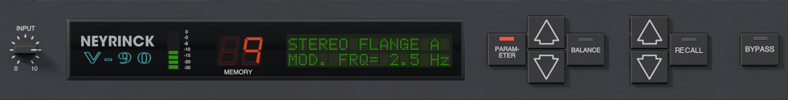

# The V-90 Panel

Every V-90 plug-in has the same front panel. V-90 Symphonic has one program, so it has no MEMORY keys or RECALL key.

From left to right:

| Control | What it does |
|---|---|
| **INPUT** | Input level, from 0 to 10. 8 is unity gain, 10 is +6 dB. |
| **Info** (the NEYRINCK V-90 logo) | Click to show the plug-in's version. Click again to hide it. |
| **Meter** | Input level after the INPUT knob, from −30 to 0 dBFS. The top three segments are orange. |
| **MEMORY** display | The number of the playing program. It blinks while you choose another one with the MEMORY keys. |
| **LCD** | Top line: the program name. Bottom line: the parameter selected and its value. |
| **PARAMETER** | Steps through the program's parameters. Its light is on when a parameter is selected. |
| **▲/▼** (left pair) | Change the value of the parameter shown on the LCD. |
| **BALANCE** | Selects the BALANCE parameter (the dry/effect mix). Its light is on while BALANCE is selected. |
| **MEMORY ▲/▼** (right pair) | Choose another program. |
| **RECALL** | Loads the program chosen with the MEMORY keys. See [Memories and Recall](memories.md). |
| **BYPASS** | Bypasses the effect. Its light is on while bypassed. |

## Changing a Value

There are several ways to change the parameter shown on the LCD:

* **Click ▲ or ▼** to change it by one step. Hold the key down to repeat.
* **Drag up or down on ▲ or ▼** for larger changes.
* **Drag up or down on the LCD.**
* **Click the LCD** and type a value, then press ++return++. Press ++escape++ to cancel. You can type the value as it is shown on the LCD, or a number: typing `8k` for a low-pass filter chooses 8.0 kHz, and a value between two steps chooses the nearest.
* **Option-click the LCD** (Alt-click on Windows) to return the parameter to the playing program's factory value.

Each parameter has the same steps as the original unit. For example, REV TIME moves in 0.1 s steps up to 5 s and in larger steps above.

## INPUT Knob

The INPUT knob sets the level into the plug-in. Set it so the meter peaks near the top of the green segments. As on the original unit, the dry part of the BALANCE mix comes after the INPUT knob, so the knob changes the level of both the dry and the effect sound. BYPASS passes the input through unchanged.

| Knob | Gain |
|---|---|
| 0 | Off |
| 2 | −24 dB |
| 4 | −12 dB |
| 6 | −6 dB |
| 8 | 0 dB (default) |
| 10 | +6 dB |

## Resizing the Window

Drag the bottom-right corner of the plug-in window to make it larger or smaller, from a quarter to four times its normal size. The plug-in remembers the size in the session.
